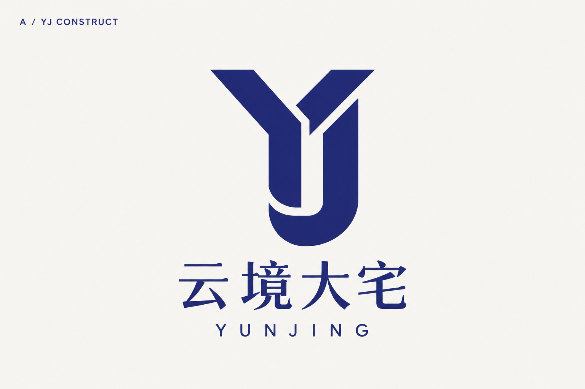
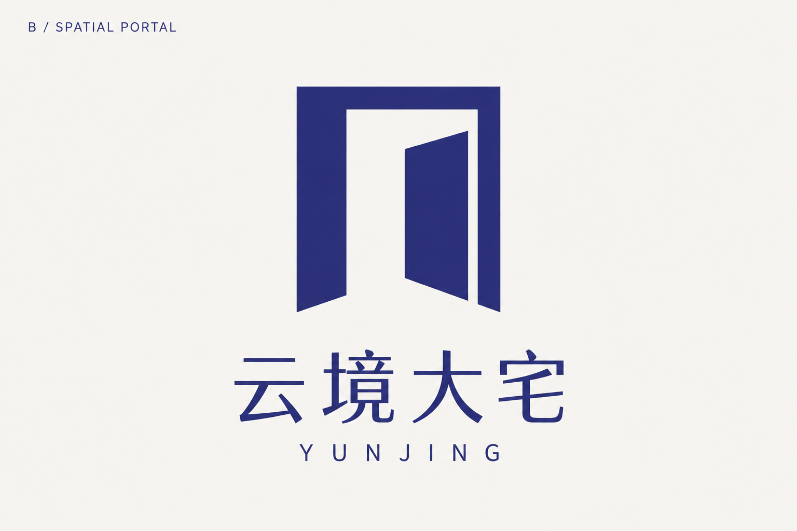
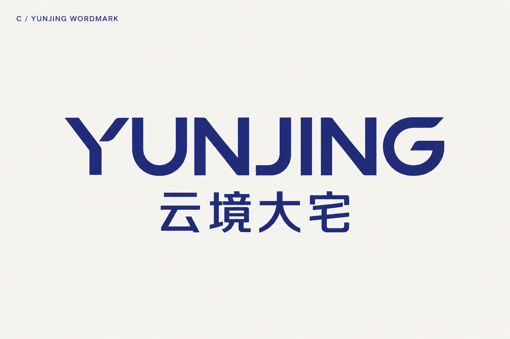

# 云境大宅 · Logo 方向探索

首轮候选图，尚未选定最终方案。

品牌服务别墅大宅、大平层及高端商业等场景，以数字化深化设计和预算前置支持全案整装交付。

主色依据：CMYK `85 / 81 / 47 / 11`。屏幕近似预览色：`#222B78`，最终应用颜色需结合色彩配置及材料打样确认。

## A · YJ 构筑

将 Y、J 融合为独立几何标记，强调结构与建造秩序。

[打开 JPG 原图](A-yj-construct.jpg)

## B · 境界之门

以门庭和空间框架表现空间规划与进入感。

[打开 JPG 原图](B-spatial-portal.jpg)

## C · YUNJING 字标

以英文名称与中文品牌名组成字体标志，强调清晰的横向识别。

[打开 JPG 原图](C-yunjing-wordmark.jpg)

三张图片均为 1536 × 1024 像素的 JPG，属于方案探索稿。
