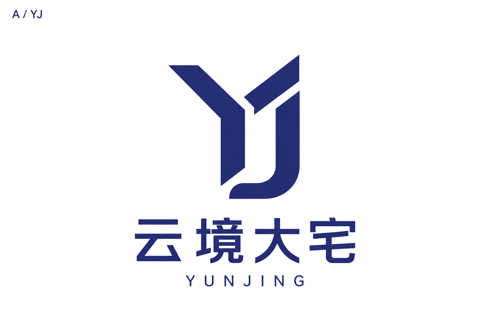
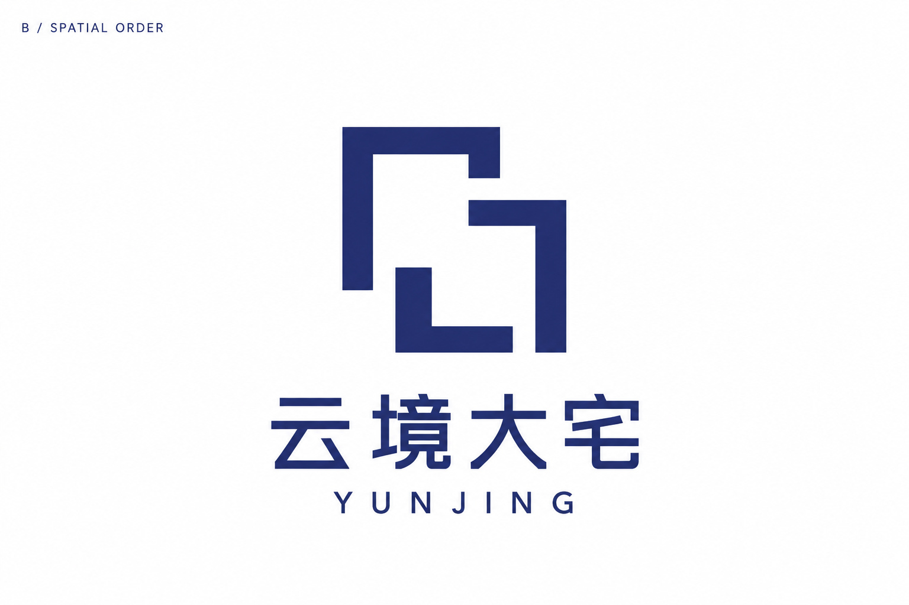
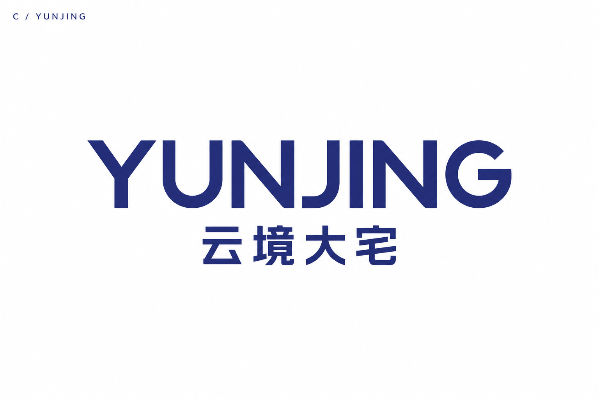

# 云境大宅 · 第二轮 Logo 探索

根据 [awesome-design-md](https://github.com/VoltAgent/awesome-design-md) 中的 [Apple DESIGN.md](../../../design-reference/apple-DESIGN.md)，重新设计三条 Logo 路线。采用简洁画布、清晰字形与留白秩序，沿用云境大宅的深靛蓝主色。

品牌适配规则见 [项目 DESIGN.md](../../../DESIGN.md)。本轮均为待选择的候选方案，尚未定稿。

## A · YJ 构筑

重新组织 Y 与 J 的连接及留白，配合现代无衬线中文。独立符号便于延伸到门店招牌、服装及材料标签。

[打开 JPG 原图](A-yj-construct.jpg)

## B · 空间秩序

用错位墙线与开口构成抽象空间图形，表达深化设计与空间组织。本轮不再使用写实开门造型。

[打开 JPG 原图](B-spatial-order.jpg)

## C · YUNJING 字标

以更清晰的直立无衬线字形建立名称识别，去掉上一轮运动化切角。后续可继续细化字距与中文权重。

[打开 JPG 原图](C-yunjing-wordmark.jpg)

## 选择与后续

可以选择 A、B 或 C，提出修改要求、组合具体元素、退回重新探索，或要求进一步推荐。选定候选后，再细化最终 Logo 图像资产与 VI。

三张图片均为 1536 × 1024 像素的 JPG。[上一轮图集](../v1/README.md)保留用于比较。
